# Create an Azure Front Door using Azure PowerShell

---

## 1. Architecture & Provisioned Resources

### Core Infrastructure Topology

| Resource Type | Resource Name | Specification / Purpose | Region / Location |
| :--- | :--- | :--- | :--- |
| **Azure Front Door** | `contosoAFD` | Standard Azure Front Door profile for global load balancing | Global |
| **Front Door Endpoint** | `contosofrontend` | Global CDN endpoint routing incoming HTTP/HTTPS traffic | Global |
| **Origin Group** | `og` | Origin group configured with health probes and load balancing settings | Global |
| **App Service (Primary)** | `Webapp-demo13o` | Primary backend web application hosted on `myAppServicePlanCentralUS` | Central US |
| **App Service (Secondary)** | `Webapp-demo23o` | Secondary backend web application hosted on `myAppServicePlanEastUS2` | East US 2 |

---

### Provisioned Environment Validation

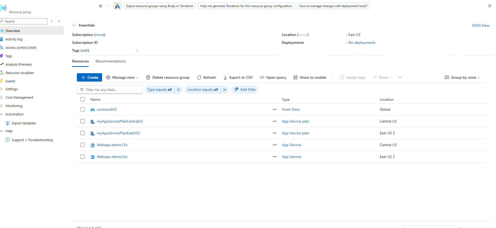

*Resource group inventory confirming successful deployment of Front Door Profile, App Service Plans, and Web Apps.*

---

## 2. Step-by-Step Implementation

### Step 1: Create Backend Web Applications

1. Created two App Service web applications in distinct geographical regions (`centralus` and `EastUS2`) using `New-AzWebApp`.
2. Verified provisioning of `Webapp-demo13o` and `Webapp-demo23o` to act as origins for Azure Front Door.

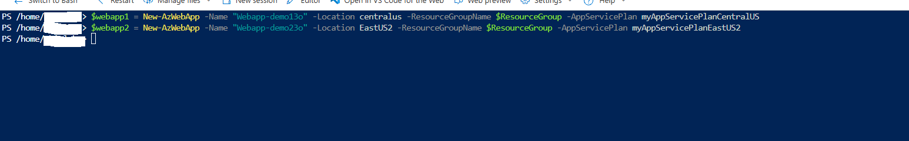

*PowerShell execution creating web applications Webapp-demo13o in Central US and Webapp-demo23o in East US 2.*

---

### Step 2: Create Azure Front Door Profile and Endpoint

1. Provisioned a Standard Azure Front Door profile named `contosoAFD` using `New-AzFrontDoorCdnProfile`.
2. Created the Front Door endpoint `contosofrontend` attached to the profile using `New-AzFrontDoorCdnEndpoint`.

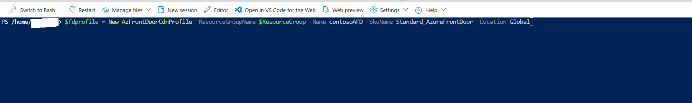

*PowerShell command creating the Standard Azure Front Door profile contosoAFD.*

---

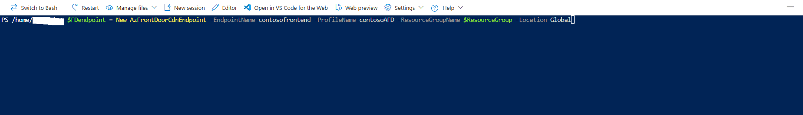

*PowerShell command creating the Front Door CDN endpoint contosofrontend.*

---

### Step 3: Configure Origin Group and Add Origins

1. Configured health probe and load balancing settings objects, then created origin group `og` using `New-AzFrontDoorCdnOriginGroup`.
2. Added `Webapp-demo13o` (`contoso1`) and `Webapp-demo23o` (`contoso2`) as origins within the origin group using `New-AzFrontDoorCdnOrigin`.

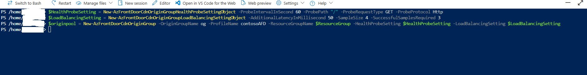

*PowerShell script defining health probes, load balancing parameters, and creating origin group og.*

---

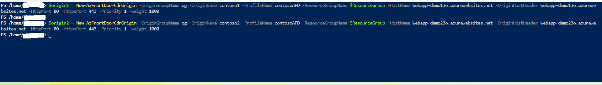

*PowerShell script adding both web app backends contoso1 and contoso2 to origin group og.*

---

### Step 4: Configure Routing Rule

1. Created routing rule `defaultroute` linking endpoint `contosofrontend` to origin group `og` using `New-AzFrontDoorCdnRoute`.
2. Enabled HTTPS redirection and linked routing rules to the default domain.

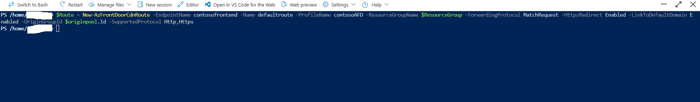

*PowerShell command creating routing rule defaultroute connecting frontend endpoint to origin group.*

---

## 3. Verification

### Step 1: Retrieve Front Door Endpoint Hostname and Test Frontend

1. Executed `Get-AzFrontDoorCdnEndpoint` to retrieve the generated Front Door endpoint hostname (`contosofrontend-c0f6a8d6ezamdnf3.z01.azurefd.net`).
2. Navigated to the Front Door URL in a browser to confirm successful routing to the backend web application.

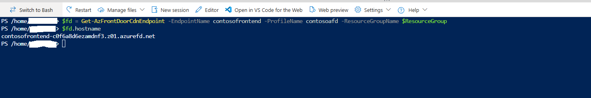

*PowerShell command retrieving the public hostname for endpoint contosofrontend.*

---

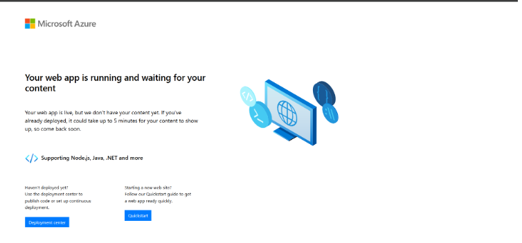

*Web browser loading default web app home page via Azure Front Door endpoint URL.*

---

### Step 2: Verify Failover Rerouting

1. Stopped the primary web application `Webapp-demo13o` using `Stop-AzWebApp` in PowerShell.
2. Refreshed the Azure Front Door endpoint in the browser to confirm automatic rerouting to secondary origin `Webapp-demo23o`.

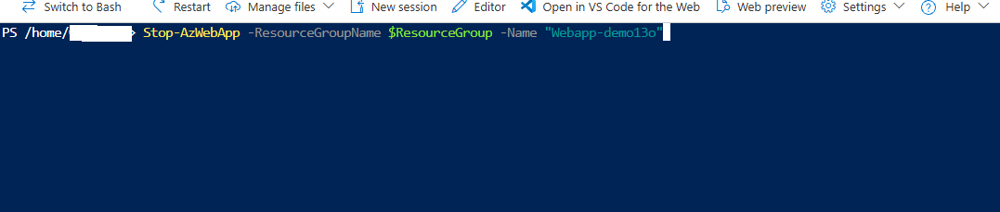

*PowerShell command executing Stop-AzWebApp to stop primary backend Webapp-demo13o.*

---

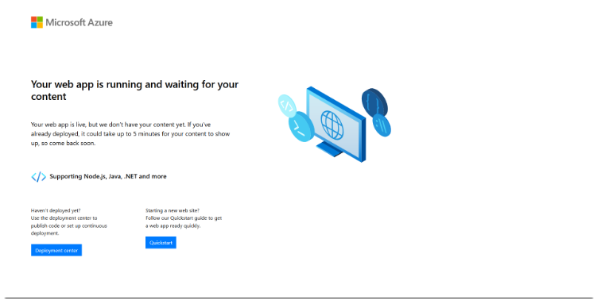

*Web browser confirming successful automatic failover rerouting to secondary web endpoint.*
